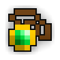

<h1><a href="https://openrotmg.org"></a> Open RotMG / Website</h1>

One-click play for the recreation of the classic bullethell game.

Development gameplay only. The full 2012 game is still being rebuilt.

Restoration data lives in `public/restoration/progress.json`. The build validates its gates and calculates both displayed percentages from it. These are reviewed evidence assignments, not a live backend test report. Artwork provenance and publication limits are in `THIRD_PARTY.md`.

[Discord](https://discord.gg/EwZWNzzYwP)

## Running locally

Requires Node 22, Python 3, and the sibling client at the revision in client-lock.json. The build prepares checksum-verified Ruffle.

Serve dist behind the same HTTPS origin as the Rust backend. Proxy /game, /client.swf, /legacy-api/, /sfx/ and /vendor/ to Rust; the backend serves its RSA-patched client and generated runtime.

```
SITE_URL=http://127.0.0.1:18924/ CLIENT_DIR=../client npm test
SITE_URL=http://127.0.0.1:18924/ CLIENT_DIR=../client npm run build
```
